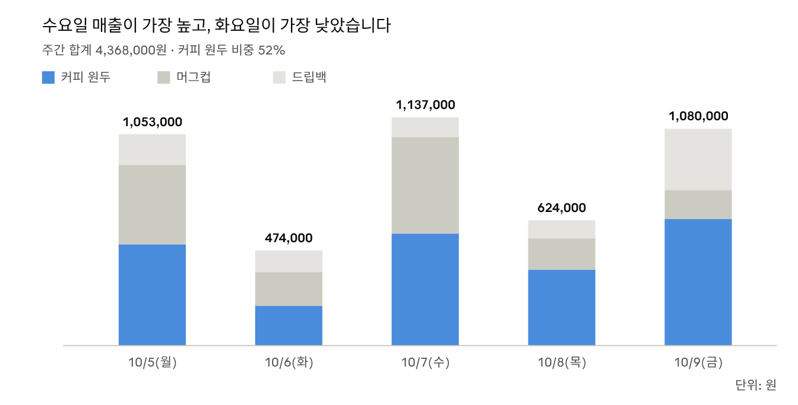

# 주간 업무 보고서 (10/5~10/9)

작성일: 2026-11-19 · 원본: [Claude 문서](https://claude.ai/artifact/N6bNcUo6xdxcbxpv3aidGf)

## 핵심 요약

- **매출**: 주간 합계는 **4,368,000원**입니다. 커피 원두가 전체의 52%(2,268,000원)를 차지했습니다.
- **고객 문의**: 104건 접수, 88건 처리로 처리율은 **84.6%**입니다. 미처리 16건 중 결제 오류가 6건으로 가장 많습니다.
- **업무**: 5건 중 완료 2건, 진행 중 2건, 대기 1건입니다. 가장 가까운 마감은 스마트스토어 상세페이지 수정(10/11)입니다.

## 매출 현황

주간 매출은 4,368,000원입니다. 요일별로는 수요일이 1,137,000원으로 가장 높았고 화요일이 474,000원으로 가장 낮았습니다.

| 요일 | 커피 원두 | 머그컵 | 드립백 | 합계 |
| --- | ---: | ---: | ---: | ---: |
| 10/5(월) | 504,000 | 396,000 | 153,000 | 1,053,000 |
| 10/6(화) | 198,000 | 168,000 | 108,000 | 474,000 |
| 10/7(수) | 558,000 | 480,000 | 99,000 | 1,137,000 |
| 10/8(목) | 378,000 | 156,000 | 90,000 | 624,000 |
| 10/9(금) | 630,000 | 144,000 | 306,000 | 1,080,000 |
| **합계** | **2,268,000** | **1,344,000** | **756,000** | **4,368,000** |

상품별 주간 매출은 커피 원두 2,268,000원, 머그컵 1,344,000원, 드립백 756,000원입니다. 수요일에는 머그컵(40개)과 원두(31개) 판매가 함께 늘었고, 금요일에는 드립백이 34개로 주중 최다였습니다.

## 고객 문의 현황

접수 104건 중 88건을 처리해 처리율은 84.6%입니다. 결제 오류는 처리율이 64.7%로 가장 낮습니다.

| 유형 | 접수(건) | 처리 완료(건) | 미처리(건) | 처리율 |
| --- | ---: | ---: | ---: | ---: |
| 결제 오류 | 17 | 11 | 6 | 64.7% |
| 상품 문의 | 26 | 22 | 4 | 84.6% |
| 교환·반품 | 32 | 28 | 4 | 87.5% |
| 배송 문의 | 29 | 27 | 2 | 93.1% |
| **합계** | **104** | **88** | **16** | **84.6%** |

요일별 접수는 화요일(27건)과 금요일(26건)에 많았습니다. 수요일에 들어온 상품 문의 2건과 결제 오류 1건은 하나도 처리되지 않았습니다.

## 업무 진행 현황

업무 5건 중 2건을 끝냈고, 남은 3건은 10/11~10/17에 마감됩니다.

| 업무 | 담당 | 상태 | 마감 |
| --- | --- | --- | --- |
| 스마트스토어 상세페이지 수정 | 이과장 | 진행 중 | 10/11 |
| 추석 선물세트 재고 정리 | 박주임 | 진행 중 | 10/14 |
| 원두 납품처 단가 협상 | 최팀장 | 대기 | 10/17 |
| 10월 이벤트 공지 | 김대리 | 완료 | 10/8 |
| 가을 신메뉴 사진 촬영 | 김대리 | 완료 | 10/7 |

## 이슈 및 다음 주 계획

- [ ] 결제 오류 미처리 6건 우선 처리, 원인 확인
- [ ] 수요일부터 남아 있는 미처리 문의 3건 처리
- [ ] 스마트스토어 상세페이지 수정 10/11 마감 준수 (이과장)
- [ ] 원두 납품처 단가 협상 착수 (최팀장, 마감 10/17). 원두가 매출의 52%라 단가가 수익에 미치는 영향이 큽니다.
- [ ] 매출이 가장 낮았던 화·목요일의 판촉 방안 검토

---
데이터 출처: `연습폴더/1_매출_이번주.xlsx`, `연습폴더/2_고객문의.xlsx`, `연습폴더/3_업무진행.xlsx`
